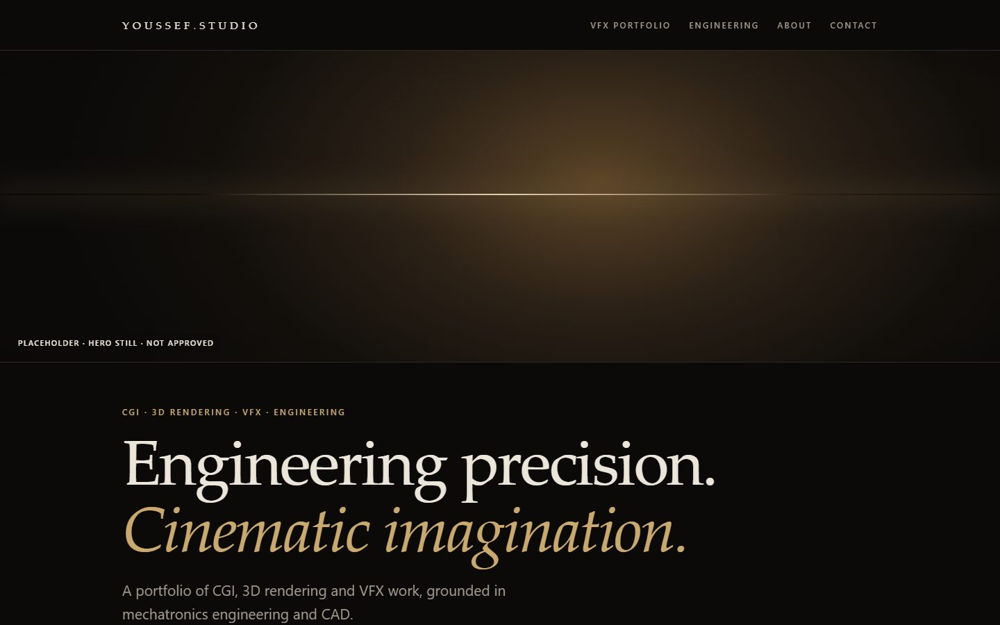
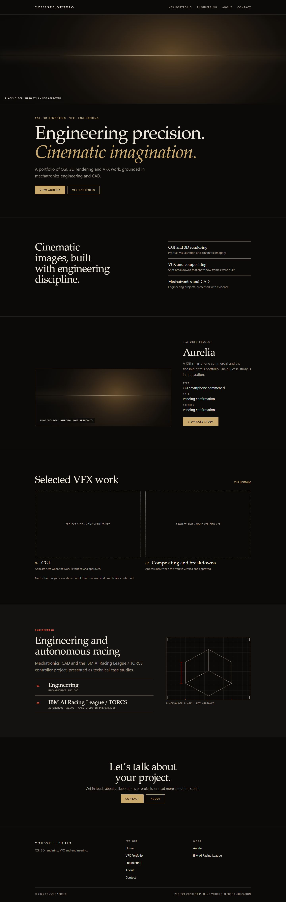
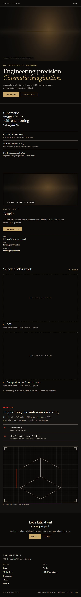
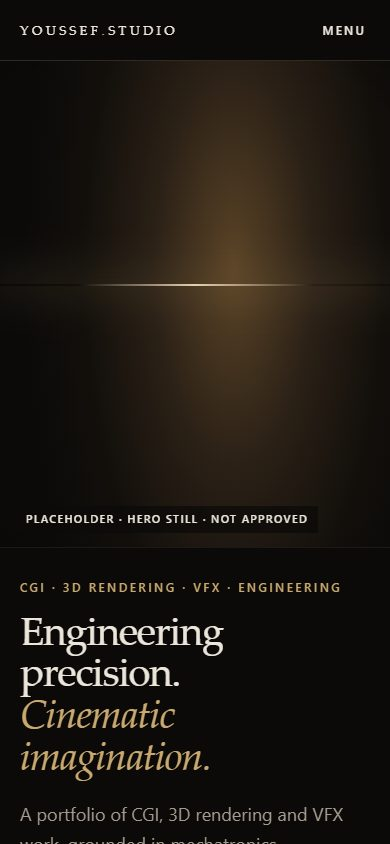
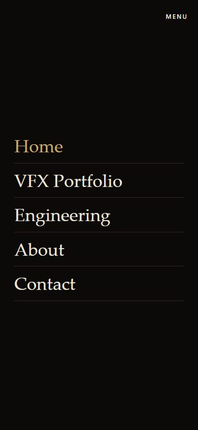
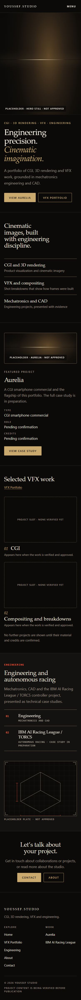

# Homepage review set

Branch `feat/m1b-homepage`. Screenshots come from the local production build (`node scripts/shoot-home.mjs`), placeholder content only. Decision context: [M1B_HOME_DECISION](../../reviews/M1B_HOME_DECISION.md). The homepage design is **not yet approved**.

What to judge: overall look and hierarchy, the hero, the left-aligned wordmark, type feel with system fonts, spacing, and the technical engineering teaser. All imagery is a labelled placeholder.

## Desktop, 1440 px

## Tablet, 768 px

## Mobile, 390 px

| Hero | Navigation menu |
| --- | --- |
|  |  |

