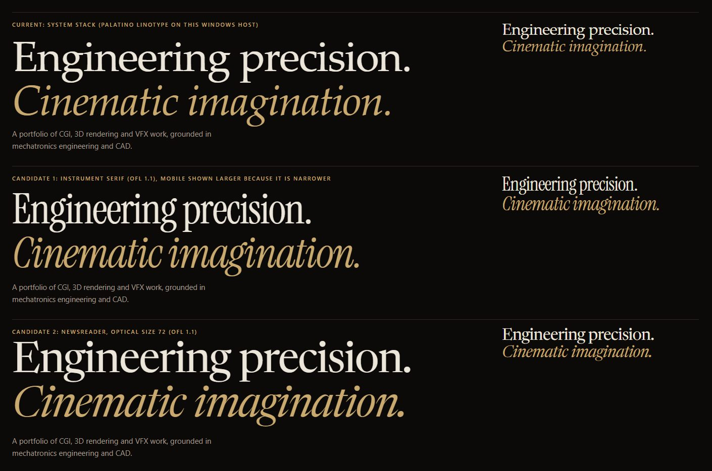

# M1b display-font evaluation

Date: 2026-10-15. Status: **evaluation only; no font is added to the site.** The homepage still uses system font stacks. Adopting either candidate needs an explicit owner decision under Q06. Related: FR-06, QA-07, QA-11, QA-13, Q06.

## What was evaluated

Two display serifs, both distributed through Google Fonts under the SIL Open Font License 1.1 (OFL). Licence evidence was read from the Google Fonts repository (`ofl/<family>/OFL.txt` and `METADATA.pb`) on 2026-10-15; confirm again from the font's own repository before shipping.

| | Instrument Serif | Newsreader |
| --- | --- | --- |
| Copyright line | The Instrument Serif Project Authors | The Newsreader Project Authors (Production Type) |
| Licence | OFL 1.1 | OFL 1.1 |
| Designers (metadata) | Rodrigo Fuenzalida, Jordan Egstad | Production Type |
| Added to Google Fonts | 2023-03-22 | 2020-07-01 |
| Styles tested | Regular and italic (a single weight) | Regular and italic at optical size 72, weight 400 |
| Latin WOFF2 size | 21,032 B regular, 22,128 B italic (43.2 KB) | 21,752 B regular, 22,856 B italic (44.6 KB) |

Files were downloaded to a scratch folder outside the repository only to render the comparison below. Nothing was bundled, committed or loaded from a third-party host by the site.

## Comparison

| Aspect | System stack (current) | Instrument Serif | Newsreader |
| --- | --- | --- | --- |
| Character | Humanist, dependable; resolves to Palatino Linotype on this Windows host, other faces elsewhere | Condensed, high contrast, very editorial and cinematic; the most distinctive | Warm, refined, close in feel to the current look; more conventional |
| Cross-device consistency | Varies by operating system (not tested off Windows) | Identical everywhere | Identical everywhere |
| Mobile headline | Fits each sentence on one line from 28 px at 320 px wide (measured by `check-home`) | Narrower, so the headline can be set larger on phones | Similar width to the system stack |
| Italic accent | Good | Expressive, strong | Good, calmer |
| Limits | None | One weight; poor below about 28 px, so display only, never body | Optical-size axis fixed at 72 in this test; the full variable file is larger |
| Added cost | None | 2 requests, about 43 KB | 2 requests, about 45 KB |

## Cost and risk if adopted

- **Budget:** about 45 KB of font data on top of the current 7 KB entry transfer is far inside the proposed 1 MB limit (QA-07). The headline is the largest contentful element until a hero image exists, so the font load would sit on the LCP path: preload only the regular face, use `font-display: swap`, and set `size-adjust`, `ascent-override` and `descent-override` on a local fallback so the swap does not shift layout.
- **Hosting:** self-host the WOFF2 files from the site with the OFL text alongside. Do not link to Google Fonts at runtime (third-party request, privacy and QA-11).
- **Not verified here:** rendering on macOS, iOS and Android; the effect on the Lighthouse variance study; the headline measurements in `check-home` would need re-baselining because widths change.

## Recommendation (for the owner to accept or reject)

Keep the system stacks for now, as decided. If the owner wants a more distinctive identity, adopt **Instrument Serif for headings only** (h1 and h2) and keep the system sans for body text. Newsreader is the safer choice if consistent rendering matters more than distinctiveness. To proceed the owner records: the chosen family (or none), then a follow-up change adds the self-hosted files, `@font-face` with fallback metrics, a preload, and a re-run of `npm run verify`, `npm run test:home` and the Lighthouse protocol.

## Decision and licence verification (2026-10-15)

The owner authorized evaluating Instrument Serif as the display font and using it for selected headings once its licence is verified from an authoritative source. Verification, read on 2026-10-15:

- The designers' repository (`Instrument/instrument-serif`) ships `OFL.txt` stating "Copyright 2022 The Instrument Serif Project Authors" under the SIL Open Font License 1.1, and GitHub's licence API reports SPDX `OFL-1.1` for the repository.
- The Google Fonts repository's `ofl/instrumentserif/OFL.txt` is byte-identical to the designers' file (matching MD5), and its metadata lists licence "OFL".
- The licence text declares no Reserved Font Name. The font files' own name table repeats the copyright and licence.
- OFL 1.1 permits embedding, use on a website and redistribution with the licence included. The font may not be sold on its own, and the licence and copyright must travel with it. Unmodified files are used, so no renaming is involved.

Applied: the two official WOFF2 files from the designers' repository (`fonts/webfonts`), unmodified, are self-hosted in `public/fonts/` with `OFL.txt` (SHA-256 of Regular `ca21b99b...4322`, Italic `4f7aacc1...c294`, 27,440 and 28,096 bytes). They are used for `h1` and `h2` only; navigation, body text, labels, card titles (`h3`) and metadata stay in the system faces. A metric-matched fallback (`size-adjust: 76%`, ascent 130%, descent 41%, computed from the font's hhea metrics and average advance widths against Palatino Linotype and Georgia) limits layout shift while the font loads. Regular is preloaded on every page, italic only on the homepage. Newsreader was not adopted.

Not verified: rendering on macOS, iOS and Android; the fallback metrics were calibrated on Windows system serifs.
